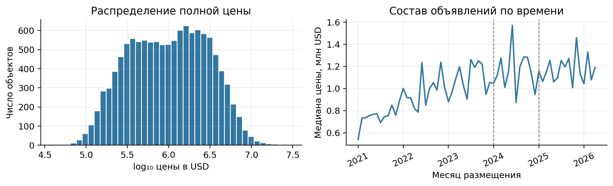
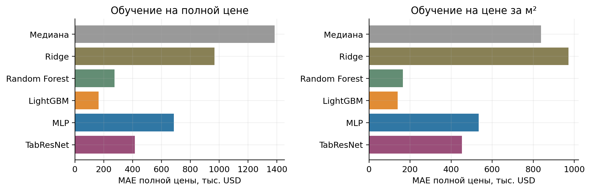
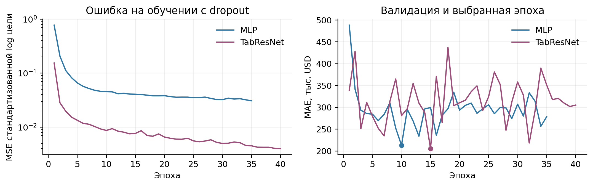
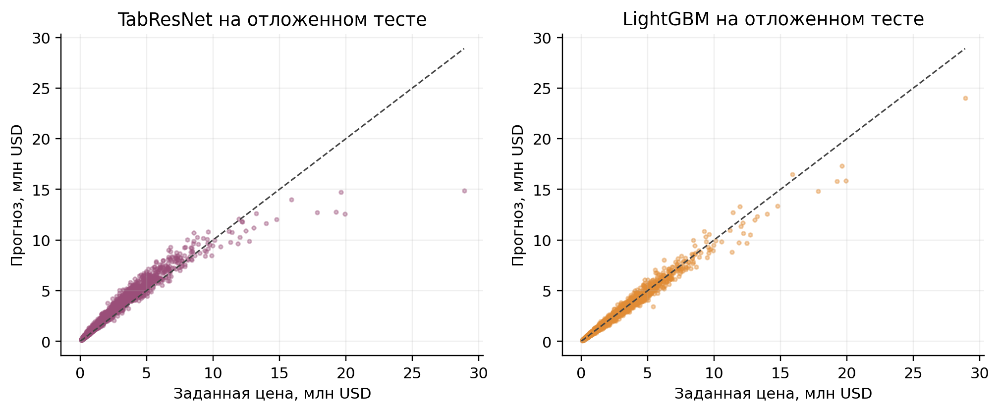
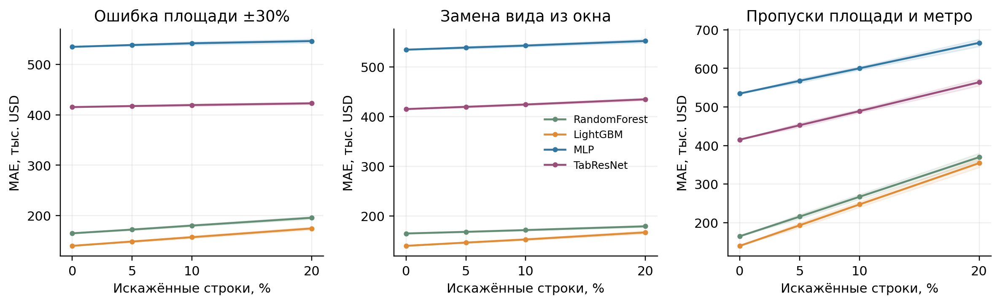
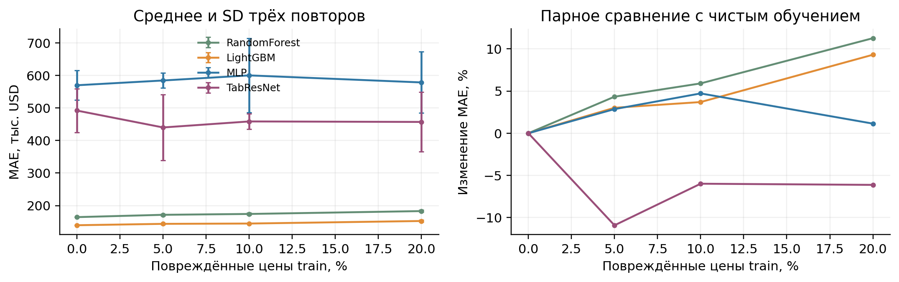
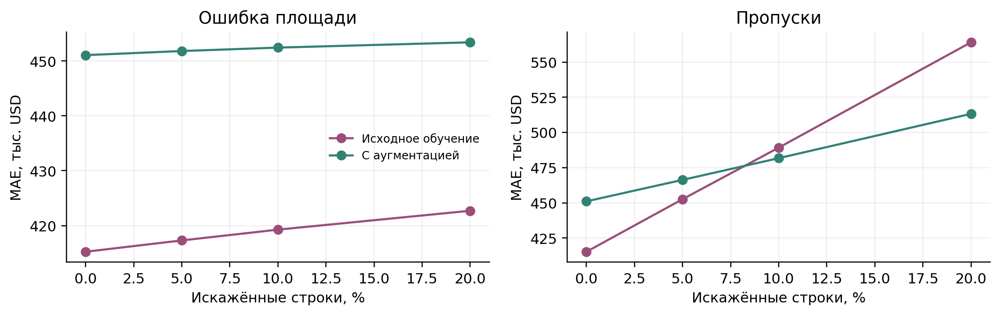
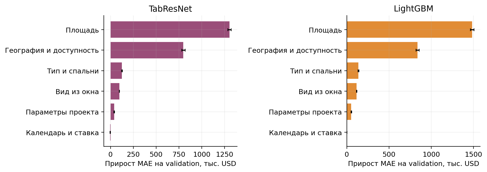
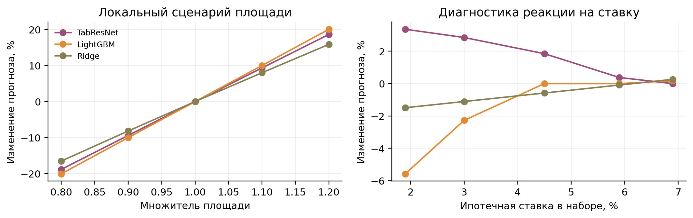

УДК 004.032.26

# Сравнение нейросетевых моделей оценки недвижимости и их устойчивости к шуму

## Аннотация

Рассматривается задача оценки стоимости строящейся недвижимости по табличным данным 12 000 объявлений Дубая. Две нейросети — многослойный персептрон (MLP) и сеть с остаточными связями (TabResNet) — сравниваются с линейной регрессией Ridge, случайным лесом, градиентным бустингом LightGBM и медианным ориентиром. Для каждой модели сопоставлены две цели обучения: полная цена и цена за квадратный метр. Качество оценено на временной выборке (2025 — апрель 2026 года) по MAE, RMSE, MAPE и R², устойчивость — при ошибках площади и категориального признака, пропусках и ошибках обучающих цен. По критерию validation выбрана LightGBM на цене за м²: MAE 139 891 USD, MAPE 7,38%, R² 0,9812. Лучшая нейросеть TabResNet получила MAE 415 240 USD и R² 0,9062. Методика исследования опирается на работы Л. Н. и В. Л. Ясницких [1–3]. Набор предположительно синтетический, поэтому выводы относятся к сравнению моделей, а не к рынку Дубая.

Ключевые слова: нейронные сети, MLP, остаточные связи, TabResNet, оценка недвижимости, цена за квадратный метр, временная валидация, устойчивость к шуму.

## Введение

Массовая оценка недвижимости — типичная задача регрессии на табличных данных: по характеристикам объекта и времени размещения нужно оценить его цену. Л. Н. и В. Л. Ясницкие предложили для неё комплексные нейросетевые модели, которые учитывают одновременно строительно-эксплуатационные параметры квартиры и показатели экономической среды [1, с. 72–74]. Прогностические свойства такой модели проверяются на примерах, не использованных при обучении, после чего обученную сеть исследуют вычислительными экспериментами: оценивают значимость входов и изменяют один входной параметр при фиксации остальных — методом «замораживания» [1, с. 75–79; 3, с. 5]. Во введении монографии [2, с. 6–7] отмечено, что модели без учёта внешней экономической среды теряют актуальность, а регрессионные модели закладывают допущение о характере зависимости и могут работать некорректно при переломе рыночной тенденции.

В настоящей работе этот подход применён к современному табличному набору и дополнен сравнением архитектур. Для табличных данных нейросети не всегда превосходят ансамбли деревьев; в работе [4] ResNet-подобная сеть названа сильным базовым вариантом, поэтому наряду с MLP исследована компактная сеть с остаточными связями TabResNet. Градиентный бустинг, случайный лес и линейная регрессия служат контролем: они показывают, даёт ли усложнение сети выигрыш на этих данных.

Цель работы — определить, как архитектура модели, постановка цели обучения и ошибки в данных влияют на качество оценки стоимости. Задачи: 1) проверить данные и подготовить признаки без утечки цены; 2) сравнить шесть подходов при двух целях — полной цене P и цене за квадратный метр P/A; 3) оценить устойчивость моделей к ошибкам площади, категориального признака, пропускам и ошибкам обучающих цен; 4) исследовать обученные модели методами Ясницких; 5) проверить перенос на поздний период и на новые проекты. Увеличение числа нейронов само по себе не считается улучшением: в работах [1, с. 73] и [3, с. 2] оптимальной оказывается небольшая сеть (три и четыре скрытых нейрона), а структуру выбирают испытанием вариантов. Поэтому модели сравниваются по ошибкам на отложенных данных и по разбросу повторных запусков.

## 1 Данные и подготовка признаков

### 1.1 Исходные данные

Исходный архив содержит пять таблиц: off_plan.csv (12 000 объявлений о строящихся объектах), secondary_sales.csv (50 000), rentals.csv (25 000), area_prices_monthly.csv (6 384) и metro_stations.csv (55). Эксперимент выполнен на off_plan.csv; продажи вторичного жилья и аренда относятся к другим процессам ценообразования и с ним не объединяются. Структура файлов соответствует набору Dubai Real Estate: Sales & Rentals (2020–2026) на Kaggle [5]. Основная таблица содержит 28 столбцов и 172 проекта; период объявлений — 2021-01-01–2026-04-29. Медиана цены составляет 1 018 100 USD, минимум — 39 200 USD, максимум — 28 897 100 USD; пропусков и повторов идентификатора нет. Оценивается заданная в наборе цена объявления в долларах США; она не тождественна цене зарегистрированной сделки.

Цены распределены в широком диапазоне, поэтому гистограмма на рис. 1 построена в логарифмической шкале. Месячная медиана зависит и от состава объектов, поэтому её нельзя читать как индекс рынка. Модели обучаются на логарифме цены, но все ошибки далее считаются в исходных USD.

### 1.2 Аудит данных

Проверка согласованности выявила 4 600 записей (38,33%), у которых год объявления раньше года запуска проекта, и 66 записей, у которых передача раньше запуска. Для реального рынка такие нарушения неправдоподобны и указывают на предположительно синтетическое происхождение набора. Поэтому результаты характеризуют сравнение моделей на учебном наборе, а не рынок Дубая. Основной эксперимент сохраняет все 12 000 строк, чтобы не менять состав выборки после просмотра ошибок; влияние нарушений оценено отдельно (раздел 6).

Из входов исключены price_per_sqft_usd и price_per_m2_usd: они вычислены через искомую цену и дали бы утечку ответа. Идентификаторы объявления и проекта, а также название проекта тоже не используются. Из двух дублирующих столбцов площади оставлен area_m2.

### 1.3 Признаки и предобработка

Таблица 1 — Группы входных признаков

| Группа | Содержание |
|---|---|
| Размер и тип | Логарифм площади, спальни, категория и тип объекта |
| Расположение | Широта, долгота, community, zone, расстояние до Burj Khalifa |
| Доступность | Станция и линия метро, log(1 + время до метро) |
| Проект | Застройщик, его категория, годы запуска и передачи, log(1 + число объектов), схема оплаты |
| Характеристика объекта | Вид из окна |
| Контекст | Число месяцев от января 2021 года, sin и cos месяца, ипотечная ставка |

Признаки строятся детерминированно, без обращения к цене. Используются 13 числовых и 10 категориальных признаков; после one-hot кодирования вход имеет размерность 226 и одинаков для всех моделей. Пропуски заполняются медианой, числовые признаки стандартизируются (StandardScaler); словарь категорий, медианы и масштабы оцениваются только на обучающей части, неизвестные категории кодируются нулями. Календарная точка отсчёта (январь 2021 года) задана константой. Таблицы цен по районам не присоединяются, так как момент доступности их агрегатов неизвестен; ипотечная ставка берётся из самого объявления.

## 2 Методика эксперимента

### 2.1 Разделение данных и выбор настроек

Таблица 2 — Временное разделение данных

| Часть | Период | Объектов | Назначение |
|---|---|---|---|
| Train | 2021–2023 | 6 738 | Обучение и предобработка |
| Validation | 2024 | 2 278 | Настройки и ранняя остановка |
| Test | 2025–29 апреля 2026 | 2 984 | Итоговая оценка |

Данные делятся по времени (табл. 2): так проверяется перенос на более поздний период, подобно проверке прогностических свойств на примерах, не участвовавших в обучении [1, с. 74]. Для каждой обучаемой модели и каждой цели на validation перебираются три заранее заданные конфигурации; всего проверено 32 сочетания алгоритма, цели и настроек (медианный ориентир настроек не имеет). Побеждает конфигурация с наименьшей MAE полной цены на 2024 год при seed 42; выбор записан в selection_frozen.json до расчёта тестовых метрик. Тестовый период известен команде по предыдущей версии проекта, поэтому он не является новой внешней выборкой, но его ответы не использовались ни для подбора настроек, ни для остановки, ни для выбора уровней шума. Одна validation-выборка служит и для остановки, и для выбора конфигурации: это ограничение небольшого поиска, а не вложенная кросс-валидация. Объём обучающей части (6 738) значительно превышает 7·N_x + 15 = 1 597 при N_x = 226 входов — критерий представительности из [1, с. 75].

### 2.2 Цели обучения и метрики

Для положительных цены P и площади A обучаются две цели: z = ln(P) и z = ln(P/A). Полная цена восстанавливается как exp(z_pred) и A_obs · exp(z_pred) соответственно, где A_obs — наблюдаемая (возможно, искажённая) площадь. Обе постановки оцениваются на одних и тех же объектах по полной цене; цена за м² — альтернативная цель на тех же строках, а не второй набор данных.

`MAE = mean(|P − P_pred|)`

`RMSE = √mean((P − P_pred)²)`

`MAPE = 100 · mean(|P − P_pred| / P)`

`R² = 1 − sum((P − P_pred)²) / sum((P − mean(P))²)`

MAE и RMSE выражены в USD, MAPE — в процентах; дополнительно считается доля прогнозов с ошибкой не более 20%. R² не является долей точных прогнозов. Определения соответствуют стандартным регрессионным метрикам [6]. В [1, с. 73–74] ошибка сети измеряется среднеквадратичной погрешностью, нормированной на размах цен; её проценты нельзя напрямую сравнивать с MAPE. Обратное экспоненцирование не даёт несмещённой оценки среднего цены; поправка на смещение не вводилась.

### 2.3 Модели

Таблица 3 — Модели и конфигурации, выбранные по validation

| Модель | Цель | Конфигурация |
|---|---|---|
| Медианный ориентир | P/A | Медиана удельной цены train × наблюдаемая площадь |
| Ridge | P | L2-регуляризация, α = 100 |
| Random Forest | P/A | 220 деревьев, min_samples_leaf = 1, max_features = 0,9 |
| LightGBM | P/A | 15 листьев, min_child_samples = 20, шаг 0,03, 985 итераций |
| MLP | P/A | 226 → 128 → 64 → 32 → 1, ReLU, dropout 0,15 |
| TabResNet | P | 226 → 128, два остаточных блока, выход 1, dropout 0,05 |

Медианный ориентир показывает качество без обучения зависимости от характеристик объекта. Ridge — линейная регрессия с L2-регуляризацией; случайный лес и LightGBM описывают нелинейные взаимодействия. Всем моделям подаются одинаковые one-hot входы, поэтому нативные категориальные возможности LightGBM не используются.

MLP — последовательность полносвязных слоёв с ReLU и dropout и линейным выходом; в отличие от сигмоидного персептрона из [1, с. 73] она глубже и обучается с dropout. TabResNet проецирует вход в пространство размерности 128 и применяет два остаточных блока; каждый блок содержит LayerNorm, Linear 128→256, ReLU, dropout, Linear 256→128 и dropout. После блоков следуют LayerNorm, ReLU и Linear 128→1.

`h_next = h + F(h)`

Остаточная связь позволяет блоку обучать поправку к текущему представлению и сохраняет прямой путь сигнала; LayerNorm нормализует скрытые признаки внутри одного объекта. Реализация собственная: она использует LayerNorm вместо BatchNorm из [4] и не заявляется как точное воспроизведение архитектуры и результатов авторов. Выбранные MLP и TabResNet содержат 39 425 и 161 793 обучаемых параметров; сеть, в четыре раза более крупная, должна подтвердить преимущество на отложенных данных.

### 2.4 Обучение нейросетей

Сети обучаются на MSE стандартизованного логарифма цели оптимизатором AdamW [8]: learning rate 0,001, weight decay 0,0001, batch size 256, ограничение нормы градиента 5, не более 220 эпох. После каждой эпохи вычисляется MAE на validation в исходных USD; сохраняются веса лучшей эпохи, обучение останавливается после 25 эпох без улучшения. LightGBM использует ту же метрику и ожидание в 100 итераций [7].

## 3 Результаты сравнения моделей

### 3.1 Качество на временном тесте

Таблица 4 — Полная цена на 2 984 тестовых объектах при seed 42

| Модель | Цель | MAE тыс USD | RMSE тыс USD | MAPE % | R² |
|---|---|---|---|---|---|
| Медианный ориентир | P | 1 383,6 | 2 326,6 | 103,56 | -0,2135 |
| Медианный ориентир | P/A | 838,1 | 1 655,5 | 38,93 | 0,3856 |
| Ridge | P | 967,9 | 1 474,9 | 58,52 | 0,5123 |
| Ridge | P/A | 971,8 | 1 499,2 | 57,52 | 0,4961 |
| Random Forest | P | 275,2 | 721,8 | 13,64 | 0,8832 |
| Random Forest | P/A | 164,8 | 346,8 | 8,51 | 0,9730 |
| LightGBM | P | 163,7 | 449,8 | 8,36 | 0,9547 |
| LightGBM | P/A | 139,9 | 289,5 | 7,38 | 0,9812 |
| MLP | P | 686,6 | 1 087,9 | 38,85 | 0,7347 |
| MLP | P/A | 534,8 | 776,3 | 34,98 | 0,8649 |
| TabResNet | P | 415,2 | 646,7 | 30,86 | 0,9062 |
| TabResNet | P/A | 453,1 | 674,1 | 30,51 | 0,8981 |

В табл. 4 и на рис. 2 показаны ошибки полной цены при seed 42. По validation выбрана LightGBM с целью P/A: MAE 139 891 USD, MAPE 7,38%, R² 0,9812. Цена за м² как цель снижает MAE полной цены у LightGBM на 14,6% и у случайного леса на 40,1%, улучшает результат MLP (686,6 → 534,8 тыс. USD); для TabResNet по validation выбрана полная цена. Линейная Ridge на validation ошибается на 402,6 тыс. USD, а на тесте — на 967,9 тыс. USD, то есть в 2,4 раза сильнее: зависимость, найденная на 2021–2023 годах, не переносится на 2025–2026. Выбранная TabResNet на 22,4% точнее выбранной MLP (415,2 против 534,8 тыс. USD), но её ошибка в 3,0 раза больше, чем у LightGBM. Для ориентира: в [1, с. 74] на тесте получен R² = 0,87; у наших сетей он равен 0,86 и 0,91, но наборы данных несопоставимы.

### 3.2 Обучение и разброс инициализаций

При seed 42 лучшие эпохи MLP и TabResNet равны 10 и 15 (рис. 3). После них MAE на validation растёт, хотя ошибка на train продолжает снижаться: это ограничение обобщения, а не повод увеличивать число эпох. Из-за dropout кривая train не совпадает с метрикой сети в режиме оценки.

Таблица 5 — Тест по трём инициализациям (seed 42, 43 и 44)

| Сеть | Цель | MAE тыс USD среднее ± SD | R² среднее ± SD |
|---|---|---|---|
| MLP | P | 678,9 ± 30,6 | 0,754 ± 0,031 |
| MLP | P/A | 569,6 ± 45,2 | 0,834 ± 0,038 |
| TabResNet | P | 491,8 ± 66,8 | 0,877 ± 0,026 |
| TabResNet | P/A | 483,1 ± 57,7 | 0,886 ± 0,025 |

Настройки повторных запусков фиксированы, лучший seed по тесту не выбирался. В основной таблице показан заранее заданный seed 42, а табл. 5 характеризует чувствительность к инициализации: например, MAE TabResNet на P равна 491,8 ± 66,8 тыс. USD. Разброс сопоставим с различиями между сетями, поэтому рост сложности не гарантирует улучшения в каждом запуске. SD по трём запускам не является доверительным интервалом.

### 3.3 Структура ошибок

У LightGBM RMSE (289 549 USD) в 2,1 раза выше MAE (139 891 USD): отдельные дорогие объекты дают крупные денежные отклонения. При этом 96,01% прогнозов LightGBM имеют относительную ошибку не более 20%, а у TabResNet такая доля равна 30,86% (рис. 4). Высокий R² нейросети поэтому нельзя отождествлять с высокой точностью оценки каждого объекта.

Таблица 6 — Кластерный bootstrap MAE при фиксированных моделях

| Модель | MAE тыс USD | 95% интервал тыс USD |
|---|---|---|
| Ridge | 967,9 | 867,8–1 075,1 |
| LightGBM | 139,9 | 119,7–159,6 |
| TabResNet | 415,2 | 373,4–457,0 |

Выполнено 2 000 повторных выборок по project_id: проект выбирается целиком со всеми его тестовыми объявлениями, что учитывает общность объектов одного проекта. Парная разность MAE TabResNet минус LightGBM равна 275,3 тыс. USD, 95% интервал — 249,2–302,7 тыс. USD: преимущество бустинга устойчиво к составу проектов. Интервал условен на обученных моделях; он не учитывает изменение рынка, подбор настроек и синтетическую природу данных и не является прогнозным интервалом для отдельного объекта.

## 4 Устойчивость к ошибкам данных

### 4.1 Протокол

Таблица 7 — Воздействия на данные

| Воздействие | Что изменяется | Что остаётся эталоном |
|---|---|---|
| Ошибка площади test | У p строк площадь умножается на U[0,7; 1,3] | Исходная полная цена P |
| Ошибка категории test | У p строк view заменяется другой категорией из train | Исходная полная цена P |
| Пропуски test | По p строк отдельно для площади и времени до метро получают NaN | Исходная полная цена P |
| Ошибка цены train | У p обучающих строк P умножается на U[0,5; 1,5] | Чистые validation и test |

Устойчивость проверяется четырьмя независимыми воздействиями (табл. 7). Уровень p = 5, 10 и 20% задан заранее и означает долю искажаемых строк, а не стандартное отклонение шума. Шум здесь — контролируемое воздействие для сравнения моделей: уровни не подбирались, чтобы понизить или улучшить метрики. Маски вложены (строки уровня 5% входят в 10% и 20%) и одинаковы для всех моделей; истинные цены теста не меняются. На тесте искажается 149, 298 и 597 строк в каждом поле, в обучающей части — 337, 674 и 1 348 цен.

Ошибки входов повторяются 10 раз при фиксированной модели seed 42; разброс отражает маску повреждений. Модели используют цель и настройки, выбранные на чистой validation, не переобучаются, пропуски заполняются статистиками train. В опыте с пропусками два столбца получают независимые маски, поэтому доля строк хотя бы с одним пропуском может превышать p. Для моделей P/A полная цена восстанавливается по наблюдаемой — ошибочной или пропущенной (тогда подставляется медиана train) — площади: ошибка влияет и на признаки, и на множитель. При ошибках обучающих цен модель переобучается с теми же настройками, чистой validation и тем же правилом остановки; для каждого уровня выполнены три парных повтора (seed 42, 43, 44 с разными масками), результат сравнивается с чистым обучением при том же seed.

Устойчивость оценивается по абсолютной MAE и её относительному изменению 100·(MAE_noise/MAE_clean − 1): небольшой относительный рост у изначально неточной модели не означает хорошей оценки стоимости.

### 4.2 Ошибки входных характеристик

Таблица 8 — MAE тыс USD при 20% повреждении каждого указанного поля

| Модель | Без шума | Площадь | Вид | Пропуски |
|---|---|---|---|---|
| Медианный ориентир | 838,1 | 843,0 | 838,1 | 953,0 |
| Ridge | 967,9 | 969,7 | 987,5 | 964,1 |
| Random Forest | 164,8 | 195,6 | 179,2 | 369,8 |
| LightGBM | 139,9 | 174,4 | 167,0 | 354,4 |
| MLP | 534,8 | 546,3 | 552,3 | 666,3 |
| TabResNet | 415,2 | 422,7 | 434,9 | 564,1 |

Для LightGBM (табл. 8, рис. 5) ошибка площади у 20% объектов повышает среднюю MAE до 174 395 USD (на 24,7%), а пропуски в площади и времени до метро — до 354 381 USD (на 153,3%): пропущенная площадь заменяется типичным значением train и особенно неточна для крупных дорогих объектов. Относительный рост у нейросетей меньше (у TabResNet при пропусках — 35,8%), но по абсолютной ошибке даже при 20% пропусков LightGBM (354,4 тыс. USD) точнее TabResNet без шума (415,2 тыс. USD).

Замена вида из окна — узкий категориальный эксперимент: ошибки застройщика, района или типа объекта не моделировались, так как их массовая случайная замена создаёт противоречивые описания. Ошибка площади является ошибкой измерения, а не реальным изменением объекта, поэтому цена в этом опыте не меняется. Отсутствие монотонного роста у отдельной модели допустимо: искажение может случайно компенсировать смещение прогноза. Среднее ± SD по повторам для всех уровней сохранено в outputs/robustness_inputs_summary.csv.

### 4.3 Ошибки обучающих цен

Таблица 9 — Результат трёх парных повторов при 20% ошибочных цен

| Модель | Чистое обучение MAE тыс USD | Шум MAE тыс USD среднее ± SD | Изменение MAE % |
|---|---|---|---|
| Ridge | 967,9 | 988,2 ± 10,8 | 2,1 |
| Random Forest | 164,6 | 183,1 ± 3,5 | 11,3 |
| LightGBM | 139,7 | 152,7 ± 3,4 | 9,3 |
| MLP | 569,6 | 578,2 ± 93,9 | 1,1 |
| TabResNet | 491,8 | 456,9 ± 91,3 | -6,1 |

При 20% ошибочных обучающих цен (табл. 9, рис. 6) средняя MAE LightGBM растёт на 9,3% (139,7 → 152,7 тыс. USD, SD 3,4 тыс.) и случайного леса — на 11,3%, тогда как Ridge и MLP почти не меняются (+2,1% и +1,1%). У TabResNet средняя MAE снижается на 6,1% (491,8 → 456,9 тыс. USD), но SD (91,3 тыс.) превышает разницу средних. Этот результат не означает, что портить цены полезно: возможны регуляризация, смена эпохи остановки и случайная компенсация смещения на позднем периоде. Три повтора дают лишь ограниченную оценку разброса, и уровень шума по такому результату не подбирался. Validation остаётся чистой, а правило остановки сохраняется, поэтому эффект ошибок меток не смешивается с изменением процедуры обучения. Воздействие — мультипликативная ошибка цены на части строк, а не гауссовский шум.

### 4.4 Аугментация обучающих входов

Проверен один заранее заданный способ повысить устойчивость выбранной нейросети. К train добавлена копия строк, у 10% которых площадь искажена в пределах ±30%, а у 5% площадь и время до метро пропущены; исходные строки и цены сохранены (13 476 обучающих примеров), validation чистая, архитектура и правило остановки прежние.

Таблица 10 — MAE выбранной нейросети тыс USD

| Условие | Исходное обучение | Аугментация | Изменение % |
|---|---|---|---|
| Чистый test | 415,2 | 451,1 | 8,6 |
| 20% ошибок площади | 422,7 | 453,4 | 7,3 |
| 20% пропусков полей | 564,1 | 513,3 | -9,0 |

На чистом тесте (табл. 10, рис. 7) MAE выросла на 8,6%, при 20% ошибок площади — на 7,3%, а при 20% пропусков снизилась на 9,0%: выигрыш в устойчивости достигнут ценой исходной точности, и оценивать эти значения нужно совместно. Опыт выполнен для одной сети и одного seed, поэтому не устанавливает универсального эффекта; это дополнительная интервенция, а не новый выбор победителя. Поскольку TabResNet обучается на полной цене, искажение площади не затрагивает цель обучения.

## 5 Исследование обученных моделей

### 5.1 Значимость групп признаков

В [1, с. 75] значимость входа оценивается по росту ошибки тестирования при его исключении и сопоставляется с корреляциями Пирсона [1, с. 75–77]. Здесь использован близкий метод без переобучения — групповая перестановка признаков на validation: связанные поля (например, community, zone, координаты и метро) переставляются между объектами совместно, для каждой группы выполнено 10 перестановок, измеряется прирост MAE в USD (рис. 8). Наибольший прирост у LightGBM даёт площадь (+1,48 млн USD; для моделей P/A частично потому, что площадь участвует и в восстановлении цены), затем расположение (+0,84 млн), тип и число спален (+0,14 млн), вид из окна (+0,11 млн) и параметры проекта (+0,05 млн); порядок у TabResNet тот же. Календарь и ставка при перестановке внутри 2024 года ошибку не меняют (437 USD у LightGBM): внутри одного года они почти не различаются, а их роль проявляется при переносе на другой период (п. 5.2). Значимость — чувствительность конкретной модели, а не причинный вклад фактора; перестановка внутри группы сохраняет связи между её полями, но может нарушать связи между группами.

### 5.2 Роль экономического контекста

Таблица 11 — Абляция календаря и ипотечной ставки

| Модель | Исходная MAE тыс USD | Без контекста тыс USD | Изменение % |
|---|---|---|---|
| LightGBM | 139,9 | 419,2 | 199,7 |
| TabResNet | 415,2 | 296,5 | -28,6 |

Чтобы проверить роль экономической среды, о которой говорится в [2, с. 6–7], месяц, календарный тренд и ипотечная ставка заменены константами train во всех частях, после чего модель переобучена с зафиксированными настройками. У LightGBM (табл. 11) исключение контекста увеличивает MAE на 199,7%: контекст нужен для переноса на 2025–2026 годы. У TabResNet, напротив, MAE снижается на 28,6%: сеть некорректно экстраполирует календарную зависимость и без неё переносится лучше. Наличие полезной информации не гарантирует, что архитектура использует её правильно. Результат не даёт оснований считать календарь и ставку причинными драйверами цены.

### 5.3 Сценарные вычислительные эксперименты

Метод «замораживания» [1, с. 77–79; 3, с. 5] применён к 400 случайным объектам validation (seed 42): один вход изменяется, остальные фиксируются; для каждого объекта вычислено парное процентное изменение прогноза, затем найдена его медиана (рис. 9).

Таблица 12 — Парное изменение прогноза при изменении площади

| Модель | Множитель площади | Изменение цены % | За диапазоном train % |
|---|---|---|---|
| TabResNet | 0,8 | -18,82 | 1,00 |
| TabResNet | 1,2 | 18,64 | 0,50 |
| LightGBM | 0,8 | -20,05 | 1,00 |
| LightGBM | 1,2 | 20,08 | 0,50 |

У моделей удельной цены (табл. 12) заметная часть реакции на площадь заложена в формуле P_pred = A_obs · exp(z_pred), поэтому почти пропорциональный рост полной цены не доказывает, что модель открыла экономический закон. Доля объектов, у которых изменённая площадь выходит за диапазон train, составляет 0,5–1,0%. Сценарий ставки (1,9–6,9%, диапазон train) служит только диагностикой: при ставке 1,9% медианный прогноз LightGBM ниже на 5,6%, а прогноз TabResNet выше на 3,4%; знаки реакции различаются, а бустинг даёт ступенчатую зависимость. Ставка тесно связана с датой, поэтому её изменение при замороженном календаре создаёт сочетания, которых не было в обучении. Аналогичный эксперимент с объёмом кредитования в [1, с. 78–79] трактуется как прогноз влияния кредитной политики на рынок; для нашего учебного набора такая интерпретация не обоснована.

## 6 Перенос на поздние даты и новые проекты, ограничения

### 6.1 Ошибка во времени

Таблица 13 — Ошибка во времени на основном test

| Период | N | LightGBM MAE тыс USD | TabResNet MAE тыс USD |
|---|---|---|---|
| 2025Q1 | 559 | 144,6 | 296,9 |
| 2025Q2 | 539 | 133,2 | 378,7 |
| 2025Q3 | 580 | 132,7 | 442,6 |
| 2025Q4 | 589 | 132,2 | 429,3 |
| 2026Q1 | 545 | 149,8 | 469,6 |
| 2026Q2* | 172 | 164,9 | 601,5 |

* Во втором квартале 2026 года представлен только апрель. Ошибка TabResNet растёт с удалением от периода обучения (табл. 13; с 296,9 до 601,5 тыс. USD), тогда как MAE LightGBM остаётся в пределах 132,2–164,9 тыс. USD. Это согласуется с проблемой экстраполяции календарной зависимости нейросетью (п. 5.2), но само по себе не доказывает единственную причину.

### 6.2 Новые проекты и качество дат

Таблица 14 — Проверка с непересекающимися project_id

| Модель | Train | Val | Test | MAE тыс USD | R² |
|---|---|---|---|---|---|
| Ridge | 8296 | 1864 | 1840 | 311,0 | 0,8935 |
| LightGBM | 8296 | 1864 | 1840 | 300,0 | 0,8957 |
| TabResNet | 8296 | 1864 | 1840 | 238,5 | 0,9462 |

Во втором эксперименте (табл. 14) 120 проектов отданы в обучение, 26 — в validation и 26 — в test; даты внутри частей перемешаны. Это перенос на новые проекты при представленном во всех частях временном диапазоне. Параметры моделей и цель перенесены из основного опыта, повторного поиска нет. Здесь TabResNet точнее LightGBM (238,5 против 300,0 тыс. USD): порядок моделей зависит от вида обобщения, так как перенос на поздние даты и на новые проекты — разные задачи. Результат получен на одном групповом разбиении и одном seed и не доказывает общего превосходства нейросетей.

Дополнительная проверка качества дат удаляет из всех частей 4 611 строк с нарушением запуска или передачи. Остаются 2 496 train, 1 920 validation и 2 973 test; в test представлены 57 проектов, отсутствующих в очищенном train. MAE составляет: Ridge — 656,7 тыс. USD; LightGBM — 217,7 тыс. USD; TabResNet — 436,7 тыс. USD. Изменились объём и покрытие обучения, поэтому эти ошибки нельзя объяснять только эффектом очистки; основной результат ими не заменяется.

### 6.3 Крупные ошибки

Таблица 15 — Три наибольшие денежные ошибки каждой модели

| Модель | ID | Цена млн USD | Прогноз млн USD | Ошибка % |
|---|---|---|---|---|
| LightGBM | O006399 | 28,90 | 24,00 | 16,9 |
| LightGBM | O009882 | 19,94 | 15,83 | 20,6 |
| LightGBM | O002200 | 19,24 | 15,78 | 18,0 |
| TabResNet | O006399 | 28,90 | 14,87 | 48,5 |
| TabResNet | O009882 | 19,94 | 12,59 | 36,8 |
| TabResNet | O002200 | 19,24 | 12,79 | 33,6 |

Наибольшие денежные ошибки (табл. 15) приходятся на самые дорогие объекты; объекты из test после анализа не удалялись. У LightGBM MAE в сегменте выше 90-го процентиля цены train равна 443 644 USD, а ниже медианы train — 33 724 USD при близкой MAPE (7,28% и 7,64%): денежная ошибка растёт с ценой, а относительная точность остаётся прежней. Границы сегментов заданы по train и не подстраивались под тестовые цены.

### 6.4 Ограничения

Главное ограничение — предположительно синтетическое происхождение набора и нарушения дат: высокая точность может отражать восстановление правил генератора, а не закономерности реального рынка, а отсутствие пропусков не подтверждает качество реальных данных. Набор не содержит проверенного ряда сделок и истории публикации каждого признака. Кроме того, поиск настроек ограничен тремя конфигурациями, использован один основной временной разрез, три инициализации сетей, три повтора искажения цен и одна конфигурация аугментации, проверены лишь некоторые виды ошибок входов, а все временные части содержат одни и те же проекты. Для оценки прикладной пригодности нужен внешний набор с подтверждённым происхождением, ценами реальных сделок и несколькими последовательными временными разрезами. По имеющимся данным корректно сравнивать алгоритмы и их устойчивость, но нельзя использовать модель как инструмент инвестиционной или оценочной практики.

## Заключение

Выполнен полный цикл моделирования: аудит данных, подготовка признаков, разделение во времени, подбор настроек по validation, итоговая оценка, исследование моделей и проверка устойчивости. Среди шести подходов по критерию validation выбрана LightGBM на цене за квадратный метр: на тесте MAE равна 139 891 USD, MAPE — 7,38%, R² — 0,9812. Переход к цене за м² снизил ошибку полной цены у LightGBM, случайного леса и MLP.

Остаточная сеть TabResNet точнее MLP (MAE 415 240 против 534 781 USD при seed 42), но уступает бустингу: её ошибка растёт к концу тестового периода, а исключение календаря её улучшает. На новых проектах порядок моделей меняется. Заметный разброс по инициализациям не позволяет считать усложнение архитектуры улучшением само по себе, что согласуется с подходом Ясницких: структура сети определяется проверкой на отложенных данных [1, с. 73; 3, с. 2].

Наиболее вредны для моделей пропуски и ошибки площади (у LightGBM при 20% пропусков MAE выше на 153%); 20% ошибок в обучающих ценах повышают MAE бустинга на 9,3%. Аугментация входов повысила устойчивость сети к пропускам ценой точности на чистых данных. Методы Ясницких — отдельная проверка, оценка значимости входов и «замораживание» — реализованы как вычислительные эксперименты; наблюдаемые реакции не объявляются причинными законами, что особенно важно для предположительно синтетических данных.

Код полного цикла, обученные модели, индивидуальные прогнозы и таблицы воспроизводятся командой python src/experiment.py --stage all (графики — python src/plots.py), версии библиотек сохранены в outputs/environment.json, исходный seed — 42. Проверки (python -m unittest discover -s tests и python src/verify_results.py) подтверждают разделение выборок, исключение ценовых производных, отсутствие обучения предобработки на будущем и корректность искажения площади. Все таблицы отчёта формируются из результатов выполнения кода.

## Библиографический список

1. Ясницкий Л. Н., Ясницкий В. Л. Разработка и применение комплексных нейросетевых моделей массовой оценки и прогнозирования стоимости жилых объектов на примере рынков недвижимости Екатеринбурга и Перми // Имущественные отношения в Российской Федерации. 2017. № 3 (186). С. 68–84. URL: https://publications.hse.ru/articles/212942576.

2. Ясницкий В. Л., Алексеев А. О., Ясницкий Л. Н. Массовая оценка и сценарное прогнозирование рыночной стоимости городской недвижимости на основе технологии нейросетевого моделирования: монография. М.: РУСАЙНС, 2019. ISBN 978-5-4365-4474-8. (Использован фрагмент: введение, с. 6–7.)

3. Ясницкий Л. Н., Внукова О. В., Черепанов Ф. М. Прогноз результатов Олимпиады-2014 в мужском одиночном фигурном катании методами искусственного интеллекта // Современные проблемы науки и образования. 2014. № 1. URL: http://www.science-education.ru/115-11339.

4. Gorishniy Y., Rubachev I., Khrulkov V., Babenko A. Revisiting Deep Learning Models for Tabular Data // Advances in Neural Information Processing Systems. 2021. Vol. 34. arXiv:2106.11959. URL: https://arxiv.org/abs/2106.11959.

5. sergionefedov. Dubai Real Estate: Sales & Rentals (2020–2026) [Электронный ресурс] // Kaggle. URL: https://www.kaggle.com/datasets/sergionefedov/dubai-real-estate-sales-and-rentals-20202026. Локальная версия данных — CSV из предоставленного архива; условия генерации набора не подтверждены.

6. Scikit-learn. Metrics and scoring: quantifying the quality of predictions. Regression metrics [Электронный ресурс]. URL: https://scikit-learn.org/stable/modules/model_evaluation.html (scikit-learn 1.8.0).

7. LightGBM. early_stopping [Электронный ресурс]. URL: https://lightgbm.readthedocs.io/en/stable/pythonapi/lightgbm.early_stopping.html (LightGBM 4.7.0).

8. PyTorch. AdamW [Электронный ресурс]. URL: https://docs.pytorch.org/docs/stable/generated/torch.optim.AdamW.html (PyTorch 2.6.0).

Дата обращения к веб-ресурсам: ноябрь 2026 года.

**NEURAL NETWORK MODELS FOR REAL ESTATE VALUATION AND THEIR ROBUSTNESS TO NOISE**

The paper compares neural and classical regression models for estimating the price of off-plan properties on a tabular dataset of 12,000 Dubai listings. A multilayer perceptron (MLP) and a residual network (TabResNet) are compared with Ridge regression, random forest, LightGBM and a median baseline; each model is trained on two targets, the full price and the price per square metre. The models are evaluated on a temporal test set (2025 – April 2026) by MAE, RMSE, MAPE and R², and their robustness is studied under area errors, categorical errors, missing values and corrupted training prices. LightGBM trained on the price per square metre was selected on validation (test MAE 139,891 USD, MAPE 7.38%, R² 0.9812); the best neural network, TabResNet, reached MAE 415,240 USD and R² 0.9062. The methodology follows the work of L. N. and V. L. Yasnitsky on complex neural network models for mass real estate valuation. The dataset is presumably synthetic, so the conclusions concern the comparison of models rather than the real Dubai market.

Keywords: neural networks, MLP, residual network, TabResNet, real estate valuation, price per square metre, temporal validation, robustness to noise.
